+++
title = "An OpenResty Worker Stuck in an Infinite Loop: How We Found a Missing LuaJIT ARM64 Instruction"
date = '2026-11-06T15:10:53+08:00'
slug = 'luajit-arm64-infinite-loop'
translationKey = 'luajit-arm64-infinite-loop'
description = "A production investigation into 100% CPU usage, a missing ARM64 store instruction, and an incorrect load/store merge in LuaJIT."
tags = ['OpenResty', 'LuaJIT', 'ARM64', 'Troubleshooting']
draft = false
+++

> A three-year production investigation: from 100% CPU usage and loops that would never terminate to discovering that LuaJIT's ARM64 code generator had dropped an instruction that should have been executed.

Our gateway runs on OpenResty, with most of its business logic written in Lua. OpenResty uses LuaJIT underneath. In JIT mode, LuaJIT compiles Lua code into machine instructions that the CPU can execute directly to improve performance. In everyday development, we usually focus on whether the Lua logic is correct. This time, however, the problem was in **the machine code generated by the JIT compiler**.

## 1. Symptoms in production

Our production fleet originally consisted entirely of x86 machines, and everything worked normally. After introducing ARM machines, we began encountering a series of LuaJIT-related problems on those machines.

The symptoms appeared **only on ARM machines**, which made us suspect an issue in LuaJIT's ARM implementation. Eventually, we disabled JIT compilation on several ARM machines and observed that the same kind of infinite loop no longer occurred. This gradually shifted our investigation from business logic toward LuaJIT. At that point, though, we still did not know which compilation stage was responsible, and we had no reliable way to reproduce the problem.

### 1.1 Symptom one: a single worker stays at 100% CPU

Occasionally, an nginx worker on an ARM machine would remain at 100% CPU for a long time.

- We attached GDB to the process and used [openresty-gdb-utils](https://github.com/openresty/openresty-gdb-utils) to inspect it. The process was stuck in a `for` loop. The location of the infinite loop varied from one incident to another.
- Each machine had 40 workers, but only one or two would be affected. The timing was unpredictable: sometimes once in seven days, sometimes several times in one day.
- Some affected workers also showed continuous memory growth. Their loops allocated memory repeatedly until the machine ran out of memory and triggered an OOM condition.

One incident occurred in `captcha_map.lua`. The business logic can be simplified to:

```lua
local coordinates = {
    {x = 10, y = 20},
    {x = 30, y = 40},
    {x = 50, y = 60},
}

for idx, point in ipairs(coordinates) do
    -- Check whether the coordinates satisfy the condition
end
```

This loop should not run forever. `idx` should advance through 1, 2, and 3, then the loop should end. Instead, the observed sequence was `1, 2, 3, 1, 2, 3, 1, 2, 3, ...`.

**In the affected worker, the index kept cycling through 1, 2, and 3.** This was more difficult than an ordinary application bug: the Lua source did not contain an obvious infinite loop.

### 1.2 Symptom two: Lua behavior that contradicts the source code

During the investigation, we also encountered production incidents that looked like values disappearing. Here are two examples from another incident report.

**Example A: a value is checked as a string, but is later reported as `nil`.**

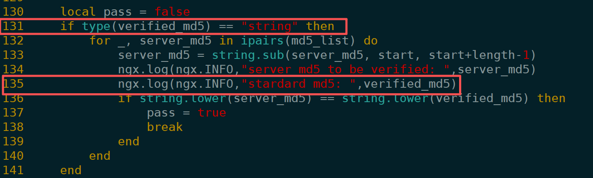

Line 131 checks that `verified_md5` is a string before entering the following code. By the time the logging statement at line 135 executes, `verified_md5` should therefore be a string.

At runtime, however, the log at line 135 reported that `verified_md5` was `nil`.

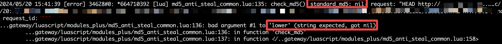

**Example B: a variable is initialized to an integer, but later reported as a function.**

In the following screenshot, the code first assigns **`local times = 0`**, which should make `times` a number.

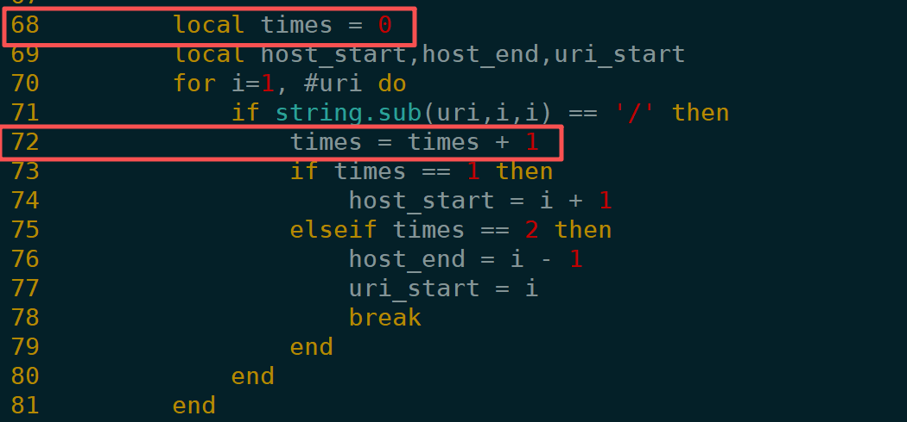

When **`times = times + 1`** executes, however, the runtime reports that the variable is a function.

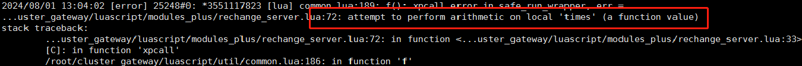

## 2. Too rare to reproduce reliably

We had roughly 2,000 ARM machines in production, each with 40 workers. Around one to three workers would exhibit the problem per day, spread across different machines.

At first, we approached it like an ordinary production incident: inspect the business code, examine logs, and try to reproduce it. None of these approaches gave us a reliable starting point.

| What we tried | What got in the way |
| --- | --- |
| Inspecting the Lua business logic | The loop conditions were normal; nothing explained an infinite loop. |
| Enabling LuaJIT compilation assertions | Execution appeared normal, and no assertion fired before the infinite loop. |
| Upgrading LuaJIT twice | Neither upgrade eliminated the problem at the time. |
| Purchasing OpenResty XRay and recording live worker execution | Recording had too much performance overhead to leave it enabled for long periods in our workload. |
| Exporting production requests from logs and replaying them offline | We could not reproduce the problem. |
| Narrowing the investigation by the domains in the triggering requests | Too many domains were still involved to identify the business feature responsible. |

Before finding the root cause, all we could do was monitor sustained 100% CPU usage, watch for individual workers allocating more than 10 GB of memory, and scan error logs periodically. We sent `kill -9` to affected workers so that the master process would restart them. This was **containment, not a fix**.

Eventually, we changed our approach:

**If we cannot reproduce the problem reliably, why not inspect exactly what an already-affected worker is executing?**

When monitoring detected a worker in an infinite loop, we sent it `kill -6` to generate a core dump. We used GDB to inspect its registers and instructions, then used Python's Unicorn emulator to replay a segment of ARM64 instructions from the core. After emulating a large number of instructions, we found that the program counter—the PC, or the address of the instruction the CPU is currently executing—kept returning to the same set of addresses.

The important questions were no longer just whether the Lua source contained a bad loop:

1. What had LuaJIT compiled this Lua code into?
2. Did the generated machine code update the loop index correctly?
3. If an instruction really was missing, which part of LuaJIT's source was responsible?

We decided to look for evidence inside LuaJIT itself.

## 3. Using jit.dump to find the missing instruction

### 3.1 What is `jit.dump`?

LuaJIT does not compile all Lua code at once. It focuses on repeatedly executed hot paths. Each compiled execution path is called a **trace**.

A useful way to think about a trace is this: **LuaJIT notices a frequently executed path and builds a machine-code shortcut for it.** A loop may involve more than one trace, and execution can jump from one trace to another.

LuaJIT's built-in `jit.dump` module can print information about these traces: Lua bytecode, the JIT compiler's intermediate representation (IR), snapshots (SNAP) of the state needed at exits, and the resulting machine code.

In OpenResty, it can be enabled as follows:

```lua
init_worker_by_lua_block {
    -- Place this at the very beginning of the block
    require("jit.dump").on("tbirsm", "/tmp/luajit-traces.log" .. ngx.worker.pid())
    --Business logic follows below
}
```

A couple of points matter:

1. The output can be large, so arrange to clean up the logs.
2. **Enable it before Lua code starts running whenever possible.** Otherwise, traces compiled earlier may be missing from the log.

The JIT log at `/tmp/luajit-traces.log` is organized from top to bottom into three parts, separated by lines beginning with `----`:

1. **Trace start:** beginning with `---- TRACE 43 start`, this identifies where trace compilation began in the Lua code and which parent trace this trace was derived from.
2. **IR:** beginning with `---- TRACE 43 IR`, this is LuaJIT's internal representation of what the code is supposed to do.
3. **Machine code (`mcode`):** beginning with `---- TRACE 43 mcode`, these are the ARM64 instructions the CPU will actually execute.

In outline, LuaJIT's compilation process is: load a Lua file → convert it to bytecode → record a hot execution path as IR → turn the IR into assembly instructions.

Here is an excerpt from `jit.dump`:

```text
---- TRACE 43 start 5/1 lrucache.lua:90
0031  TSETS    7   2   1  ; "next"       (lrucache.lua:90)
0000  . . FUNCC               ; ffi.meta.__newindex
0032  TSETS    2   7   0  ; "prev"       (lrucache.lua:91)
0000  . . FUNCC               ; ffi.meta.__newindex
0033  MOV      2   7       (lrucache.lua:92)
0034  JFORL    3   5       (lrucache.lua:87)
---- TRACE 43 IR
0001 x27      int SLOAD  #5    PI
0002 x28      int SLOAD  #6    PRI
0003 x25      p64 PVAL   #10
0004 [8]      cdt CNEWI  +161  0003
....              SNAP   #0   [ ---- ---- ---- ---- ---- 0001 0002 +1   ---- 0004 ---- ]
...........
---- TRACE 43 mcode 188
ffff8d5bfa60  mov   x25, x28
ffff8d5bfa74  mov   w1, #16
...
ffff8d5bfb10  add   x30, x0, x1, lsl #47
ffff8d5bfb14  str   x30, [x19, #16]
ffff8d5bfb18  b     0x8d5cfc0c
---- TRACE 43 stop -> 5
```

### 3.2 Replaying the ARM64 infinite loop with Python and Unicorn

After a worker became stuck, we sent it `kill -6` to generate a core dump. We opened the core in GDB and inspected the backtrace with `bt`:

```text
(gdb) bt
#0  0x0000ffff8d4072e8 in ?? ()
#1  0x0000ffe5181ddb80 in ?? ()
#2  0x0000000001447740 in ?? ()
#3  0x0000000000000000 in ?? (
```

The function names are all `??`. GDB can read registers and memory from the core, but LuaJIT's runtime-generated machine code does not have the same complete debug symbols as an ordinary C function. As a result, `bt` often shows only machine-code addresses, without identifying the corresponding Lua source line.

In this affected worker, frame `#0`, at `0x0000ffff8d4072e8`, is the address currently held in the PC. It points into machine code generated by LuaJIT. Frame `#1` is not meaningful here because the stack cannot be unwound normally through these JIT-generated calls.

For comparison, a normal backtrace looks like this:

```text
#0  epoll_wait (epfd=5, events=0x145acc0, maxevents=512, timeout=timeout@entry=63979) at ../sysdeps/unix/sysv/linux/epoll_wait.c:30
#1  0x000000000044b808 in ngx_epoll_process_events (cycle=0x14d1f60, timer=63979, flags=1) at src/event/modules/ngx_epoll_module.c:800
#2  0x0000000000442d56 in ngx_process_events_and_timers (cycle=cycle@entry=0x14d1f60) at src/event/ngx_event.c:257
#3  0x0000000000449c72 in ngx_worker_process_cycle (cycle=cycle@entry=0x14d1f60, data=data@entry=0x0) at src/os/unix/ngx_process_cycle.c:811
#4  0x0000000000448687 in ngx_spawn_process (cycle=cycle@entry=0x14d1f60, proc=0x449c00 <ngx_worker_process_cycle>, data=0x0, 
    name=0x539267 "worker process", respawn=respawn@entry=1) at src/os/unix/ngx_process.c:199
#5  0x000000000044ad81 in ngx_reap_children (cycle=0x14d1f60) at src/os/unix/ngx_process_cycle.c:678
#6  ngx_master_process_cycle (cycle=<optimized out>) at src/os/unix/ngx_process_cycle.c:180
#7  0x00000000004231d8 in main (argc=<optimized out>, argv=<optimized out>) at src/core/nginx.c:385
```

We then wrote a Python script to read the register state from the core and emulate the machine instructions. The PC repeatedly returned to particular instruction addresses, such as `ffff8d4072e8`.

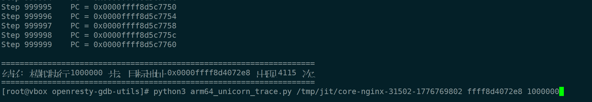

We searched the JIT log at `/tmp/luajit-traces.log` for `ffff8d4072e8` and found that it was the start address of trace 2235. The relevant excerpts were:

```text
---- TRACE 60 start captcha_map.lua:278
---- TRACE 60 IR
ffff8d5c8118 mov x7, #0x3a98
.........
ffff8d5c8348 b   0xffff8d5c77ec

---- TRACE 64 start 60/3 captcha_map.lua:279
---- TRACE 64 IR
---- TRACE 64 mcode 320
ffff8d5c76a4 mov x7, #0x3a98
.........
ffff8d5c787c b   0xffff8d5c77ec

---- TRACE 2235 start 64/3 captcha_map.lua:279
0005  TGETS    9   8   1  ; "x"       (captcha_map.lua:279)
...
0022  JITERL   7  60       (captcha_map.lua:278)
---- TRACE 2235 IR
.....
---- TRACE 2235 mcode 320
ffff8d4072e8 mov x27, x26
.........
ffff8d407424 b 0x8d5c8118
---- TRACE 2235 stop -> 60
```

Combining the emulated PC sequence with `jit.dump`, the core dump, and GDB, we identified this execution chain:

```text
TRACE 60  →  TRACE 64  →  TRACE 2235
    ↑                         |
    └─────────────────────────┘
```

The PC kept jumping between the machine code of traces 60, 64, and 2235. The infinite loop was therefore inside this trace chain.

The exported JIT logs linked these traces to the following Lua code: the `for` loop at line 278.

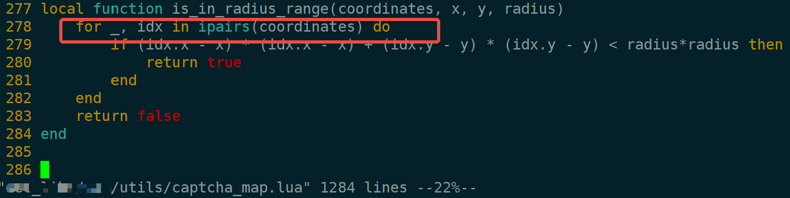

From the code, we inferred that the `coordinates` array had exactly three elements. `idx` should have advanced through 1, 2, and 3, then terminated the loop. Instead, it repeated `1, 2, 3, 1, 2, 3, ...` indefinitely.

The repeating sequence had to be 1, 2, and 3, rather than 1, 2, 3, 4, and so on: an index of 4 would be beyond this three-element array and would cause an error or terminate the iteration.

We had located the affected worker, yet the source code still looked correct. Next, we compared its JIT log with the log produced by a healthy worker executing the same code.

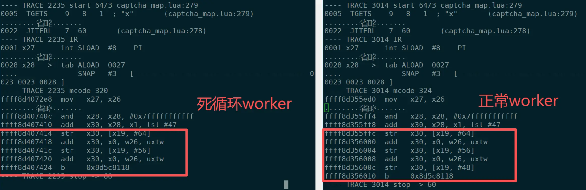

The affected worker is on the left; the healthy worker is on the right. The JIT logs were almost identical. The key difference was at the end of the generated assembly: the affected worker had **two `str` instructions**, while the healthy worker had **three**.

- The bytecode was identical in both workers.
- The IR was identical, including the snapshot.
- The `mcode` sizes differed: **trace 2235 was 320 bytes, while trace 3014 was 324 bytes**.

ARM64 instructions are four bytes long. The difference was exactly one instruction. Looking at the ends of the two machine-code sequences:

1. Both workers ended with a `b` instruction that jumped to another address: trace 60.
2. The affected worker's penultimate instruction matched the healthy worker's third-to-last instruction: an `add` that performed a register calculation.
3. The healthy worker's penultimate instruction was a `str`, which stored a register value to memory. That instruction was missing from the affected worker.

```asm
; Healthy trace 3014
add  x30, x28, x1, lsl #47
str  x30, [x19, #64]      ; slot 10
add  x30, x0, w26, uxtw
str  x30, [x19, #56]      ; slot 9
add  x30, x0, w26, uxtw
str  x30, [x19, #48]      ; slot 8   <-- Present in the healthy worker
b    <jump back to trace 60>

; Infinite-loop trace 2235
add  x30, x28, x1, lsl #47
str  x30, [x19, #64]      ; slot 10
add  x30, x0, w26, uxtw
str  x30, [x19, #56]      ; slot 9
add  x30, x0, w26, uxtw   ; The value has been calculated
b    <jump back to trace 60>      ; But the str for slot 8 is missing
```

The corresponding IR snapshot included:

```text
0023 x26 int ADD 0001 +1 ...
SNAP #3   [ ---- ---- ---- ---- ---- ---- ---- ---- 0023 0023 0028 ]
                                                    slot8 slot9 slot10
```

The first line is straightforward: **increment the loop index by one**. `SNAP` records the Lua state that must be restored when a trace exits and in related situations. It is not a one-to-one list of machine instructions, but it helps us check whether computed values are propagated correctly.

Slot 8 holds the loop-control variable used by `ipairs`. Reference `0023` is the incremented index, computed by `ADD 0001 +1`. With the store missing, the next iteration—after jumping back to trace 60—reads the old index through `SLOAD #8`, and the loop keeps repeating the same elements.

To see why losing a single `STR` can cause an infinite loop, consider how traces 60, 64, and 2235 execute together.

First, two instructions are worth spelling out:

- `SLOAD #8` reads the loop index `idx` from slot 8 of the Lua stack.
- `STR x30, [x19, #48]` writes the newly calculated index, encoded as a Lua value, back to slot 8.

**Normal execution:**

```text
TRACE 60
    Read idx from slot 8; assume its current value is 1
        ↓
TRACE 64
    Continue the loop body and advance the index
        ↓
TRACE 2235
    Assume the newly calculated idx is 4
    Execute STR, writing the new index 4 back to slot 8
        ↓
Jump back to TRACE 60
    Read idx = 4 from slot 8
    Continue or terminate iteration using the updated index
```

**Faulty execution, with one `STR` missing from trace 2235:**

```text
TRACE 60
    Read idx = 1 from slot 8
        ↓
TRACE 64
    Continue the loop body and advance the index
        ↓
TRACE 2235
    Calculate the new idx = 4
    STR is missing, so slot 8 is not updated
        ↓
Jump back to TRACE 60
    Read idx from slot 8; it is still 1
        ↓
TRACE 64 → TRACE 2235 → TRACE 60
    Repeat indefinitely
```

**The essential problem was that the new loop index had been calculated in a register but had not been written back to the Lua stack.**

Trace 2235 eventually jumps back to trace 60. Trace 60 reloads the index from slot 8, sees the old value, and repeats the same execution path. The result is an infinite loop.

For the first time, we had narrowed “a Lua iteration gets stuck” down to a specific observation:

**LuaJIT had computed the new loop index, but the generated ARM64 machine code was missing a necessary `STR` instruction to store it.**

Why had that instruction disappeared?

Had the assembler failed to emit it, or had it been generated and then overwritten later during code generation?

To answer that question, we began reading LuaJIT's ARM64 assembler, focusing on `lj_asm_arm64.h` and `lj_emit_arm64.h`.

Our conclusion at this point was:

> **The affected worker was missing one assembly instruction. The problem was in code generation, rather than the IR or the business logic.**

## 4. Reading the source

While reading the source, we also consulted Kong's ARM64 investigation, [Troubleshooting an Intermittent Failure on ARM64](https://konghq.com/blog/engineering/troubleshooting-an-intermittent-failure-on-arm64). It drew our attention to the optimization that merges memory-access instructions on ARM64.

We also noticed a comment in `emit_lso()` explaining that `str` instructions can be merged.

Our initial hypothesis was therefore that the missing `str` might have been generated, then lost as a consequence of instruction merging.

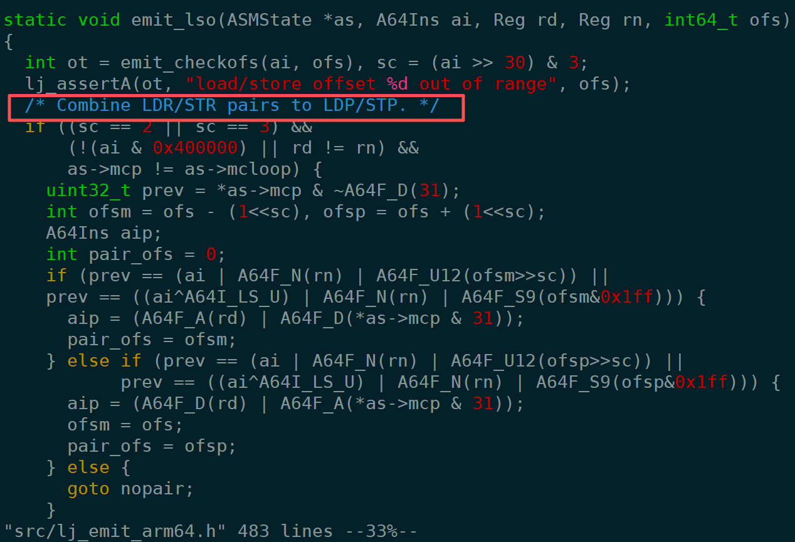

### 4.1 Some background

**First: the machine code for multiple traces can occupy adjacent regions of JIT memory.**

We examined three consecutive traces in the `jit.dump` output:

```text
---- TRACE 2233 mcode 128
ffff8d40747c ldr x30, [x22, #368]
......
ffff8d4074f8 b   0x8c6bcd28
---- TRACE 2233 stop -> interpreter

---- TRACE 2234 mcode 24
ffff8d40744c mov x0, #0
......
ffff8d407460 b   0x8c6bcd28
---- TRACE 2234 stop -> interpreter

---- TRACE 2235 mcode 320
ffff8d4072e8 mov x27, x26
......
ffff8d407424 b   0x8d5c8118
---- TRACE 2235 stop -> 60
```

<!---->

```text
TRACE 2233: ffff8d40747c ... ffff8d4074f8
TRACE 2234: ffff8d40744c ... ffff8d407460
TRACE 2235: ffff8d4072e8 ... ffff8d407424
```

The code addresses of these traces become progressively lower. LuaJIT's ARM64 assembler emits instructions from higher addresses toward lower addresses. This raised a question: could different compilation attempts reuse memory that had previously been occupied?

The later traces in this region clearly used lower addresses. Reading the machine-code allocator and ARM64 assembler confirmed that LuaJIT places multiple traces within allocated machine-code regions and that the ARM64 assembler generally **emits instructions from high addresses to low addresses**.

That suggested another possibility: **if a previous compilation failed partway through, could the machine-code bytes already written remain in memory and be encountered by a later compilation?**

**Second: trace compilation can abort, leaving machine-code bytes behind.**

The production logs contained many entries like these:

```text
---- TRACE 2235 abort sbw_preload_up_rewrite_pre.lua:47
---- TRACE 2235 start config.lua:569
---- TRACE 2235 abort config.lua:590
---- TRACE 2235 start ssl_cert_by.lua:108
---- TRACE 2235 abort ssl_cert_by.lua:140
```

An `abort` means that the trace compilation did not succeed. The corresponding machine-code space can be reused by later compilations, but the previously written bytes are not cleared.

The relevant code included the following:

```c
static int trace_abort(jit_State *J)
{
  ....
  lj_mcode_abort(J);
}

/* Abort the reservation. */
void lj_mcode_abort(jit_State *J)
{
  if (J->mcarea)
    mcode_protect(J, MCPROT_RUN);
}

static void mcode_protect(jit_State *J, int prot)
{
  if (J->mcprot != prot) {
    if (LJ_UNLIKELY(mcode_setprot(J->mcarea, J->szmcarea, prot)))
      mcode_protfail(J);
    J->mcprot = prot;
  }
}

```

On this path, `lj_mcode_abort()` mainly calls `mcode_protect()` to restore the machine-code region's runtime memory protection.

It neither clears the machine code already written nor commits the space reserved by the failed compilation.

Consequently, if a trace has already reached machine-code generation and written some instructions before aborting, those bytes can remain at their original addresses until a later compilation reuses the space.

**Third: ARM64's `emit_lso()` tries to merge adjacent memory instructions.**

In `lj_emit_arm64.h`, we focused on the optimization in `emit_lso()` that combines adjacent `LDR`/`STR` instructions into `LDP`/`STP`. For example:

```asm
str x4,  [x19, #48]
str x30, [x19, #56]
```

When the pairing conditions are satisfied, these can be combined into one `STP`:

```asm
stp x4, x30, [x19, #48]
```

This is normally a valid optimization. But **what if the instruction selected as a pairing candidate was not generated by the current compilation at all, but was stale content left in memory?**

**Fourth: trace compilation reserves one or two instruction slots at the tail.**

In the older `asm_tail_prep()` in `lj_asm_arm64.h`, the non-loop branch reserves two slots: one for a later branch and another for stack-pointer adjustment.

```c
MCode *p = as->mctop - 1;
as->mcp = p - 1;
as->invmcp = NULL;
*p = 0;
```

Only `*p` is cleared here; `p[-1]` is not. Meanwhile, `as->mcp` points exactly to `p[-1]`.

This led to a more specific hypothesis: **if an old `STR` remained in the reserved slot `p[-1]`, could `emit_lso()` mistakenly treat it as an instruction belonging to the current trace and merge it with a new instruction?**

### 4.2 Our hypothesis, step by step

Combining these observations, we modeled the following scenario:

1. A trace compilation aborts, leaving a `STR` in machine-code memory.
2. A shorter trace then compiles successfully and overwrites only part of those old instructions.
3. During the next trace compilation, the stale `STR` is mistaken for a current instruction and used in a merge.

<!---->

```text
Initial state: J->mctop = T
(T-1 and T-2 are adjacent instruction slots, each four bytes wide)

━━━━━━━━━━━━━━━━━━━━━━━━━━━━━━━━━━━━━━━━━━━
Step 1: a trace starts assembly, then aborts
━━━━━━━━━━━━━━━━━━━━━━━━━━━━━━━━━━━━━━━━━━━

asm_tail_prep:
p = T-1
mcp = T-2 (two reserved slots: T-1 is zeroed; T-2 is not)

*--mcp = ... mcp = T-3 ← instruction 1
*--mcp = ... mcp = T-4 ← instruction 2
*--mcp = ... mcp = T-5 ← instruction 3
*--mcp = ... mcp = T-6 ← instruction 4 (str x30, [x19, #56]) ← target!
*--mcp = ... mcp = T-7 ← instruction 5

Abort! This compilation is not committed.
Later traces can reuse the space, but the bytes are not cleared.

Memory now:
T-1: 0 ← cleared by asm_tail_prep
T-2: [not cleared; may contain old data]
T-3: instruction left behind by the aborted compilation
T-4: instruction left behind by the aborted compilation
T-5: instruction left behind by the aborted compilation
T-6: str x30, [x19, #56] ← left behind by the aborted compilation ★
T-7: instruction left behind by the aborted compilation


━━━━━━━━━━━━━━━━━━━━━━━━━━━━━━━━━━━━━━━━━━━
Step 2: another, shorter trace compiles successfully
━━━━━━━━━━━━━━━━━━━━━━━━━━━━━━━━━━━━━━━━━━━

This trace emits only two ordinary instructions.
asm_tail_prep: mcp = T-2
*--mcp = ... mcp = T-3 ← overwrites the old instruction at T-3
*--mcp = ... mcp = T-4 ← overwrites the old instruction at T-4
asm_tail_fixup: T-1 = NOP, T-2 = branch ← writes the tail branch

Compilation succeeds; J->mctop = T-4
(Assume a non-loop trace with spadj = 0.)

Memory now:
T-1: NOP ← written by the successful trace
T-2: branch ← written by the successful trace
T-3: instruction from the successful trace ← overwrites the old bytes
T-4: instruction from the successful trace ← overwrites the old bytes
T-5: instruction from the aborted compilation ← untouched
T-6: str x30, [x19, #56] ← stale instruction, still untouched! ★
T-7: instruction from the aborted compilation


━━━━━━━━━━━━━━━━━━━━━━━━━━━━━━━━━━━━━━━━━━━
Step 3: the faulty trace starts compiling from T-4
━━━━━━━━━━━━━━━━━━━━━━━━━━━━━━━━━━━━━━━━━━━

asm_tail_prep:
p = T-5
mcp = T-6 ← still contains the stale str x30, [x19, #56]! ★

The first instruction to emit is: str x30, [x19, #48]
emit_lso reads *mcp: the old str x30, [x19, #56] at T-6.
Offsets #48 and #56 differ by 8 bytes and satisfy the STR → STP pairing conditions.

*mcp = stp x30, x30, [x19, #48]
    ← the merged STP is written at T-6
    ← pairing returns immediately; mcp does not move to a lower address

*--mcp = ... mcp = T-7
    ← the second instruction: add x30, x0, w26, uxtw

asm_tail_fixup:
T-5 = NOP
T-6 = branch ← overwrites the STP just produced by merging

Memory now:

T-1: NOP ← written by the previous successful trace
T-2: branch ← written by the previous successful trace
T-3: instruction from the previous successful trace
T-4: instruction from the previous successful trace
T-5: NOP ← written by the faulty trace
T-6: branch ← written by the faulty trace, overwriting the STP
T-7: add x30, x0, w26, uxtw ← written by the faulty trace
     The required str x30, [x19, #48] has disappeared! ★
```

In the production JIT log, trace 2235 was the one that went wrong. Before it, we observed 32 failed attempts at trace 2234, one successful trace 2234, and 55 failed attempts at trace 2235. These frequent aborts and retries strengthened our suspicion that stale instructions in reused machine-code memory were participating in a merge.

### 4.3 Trying to reproduce it offline

To test this hypothesis, we wrote a simplified Lua program that reproduced the loop structure in the production `captcha_map.lua` as closely as possible.

The test data included both integers and floating-point numbers so that LuaJIT would generate IR and machine code structurally similar to production trace 2235.

Without fault injection, the test program terminated normally. Its ARM traces had a loop-tail structure similar to the one in the affected production trace.

```lua
--LUAJIT_REPRO_FORCE_TAILPAIR_TRACE=9 LUAJIT_REPRO_DUMP=/tmp/jit_repro_force.dump ./luajit /root/zengjinji/luajit_ipairs_trace_simple.lua

local jit = require("jit")
jit.off()
local dump_path = os.getenv("LUAJIT_REPRO_DUMP")
local dump_flags = "tbirsm"
local warmup_iters = 200

local target_iters = 20

local function force_number(v)
  return v + 0.1 - 0.1
end

local function is_in_radius_range(coordinates, x, y, radius)
    for _, idx in ipairs(coordinates) do
        if (idx.x - x) * (idx.x - x) + (idx.y - y) * (idx.y - y) < radius * radius then
            return true
        end
    end
    return false
end

local int_coordinates = {
    { x = 135, y = 119 },
    { x = 202, y = 202 },
    { x = 326, y = 148 },
    { x = 403, y = 198 },
}

local mixed_coordinates = {
    { x = 135, y = 119 },
    { x = 202, y = 202 },
    { x = force_number(326), y = force_number(148) },
    { x = 403, y = 198 },
}

local int_x = 231
local int_y = 106
local num_x = force_number(231)
local num_y = force_number(106)
local radius_num = force_number(60 * 1.5)
jit.on()
jit.opt.start("hotloop=1", "hotexit=1")
jit.flush()

require("jit.dump").on(dump_flags, dump_path)


for _ = 1, warmup_iters do
    is_in_radius_range(int_coordinates, int_x, int_y, radius_num)
end
for _ = 1, warmup_iters do
    is_in_radius_range(int_coordinates, num_x, num_y, radius_num)
end
for _ = 1, warmup_iters do
    is_in_radius_range(mixed_coordinates, num_x, num_y, radius_num)
end
for _ = 1, target_iters do
    is_in_radius_range(mixed_coordinates, num_x, num_y, radius_num)
end
```

We exported the generated JIT output and compared it with the production log. The IR and assembly produced for this test were largely consistent with the faulty production trace 2235:

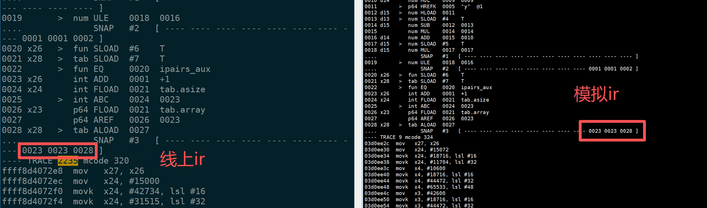

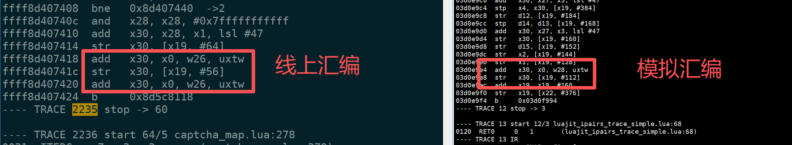

Running the test script alone did not reliably reproduce the stale instructions observed in production. We therefore modified LuaJIT, based on `v2.1-20201027`, to add a fault-injection switch used only for testing.

When compiling a designated trace—trace 9—we deliberately wrote `STR x30, [x19, #56]` into the reserved slot `p[-1]` in `asm_tail_prep()`, simulating an old instruction left in that memory.

We then checked whether `emit_lso()` would incorrectly merge that injected instruction with the newly requested `STR x30, [x19, #48]`.

```diff
--- a/src/lj_asm_arm64.h
+++ b/src/lj_asm_arm64.h
@@ -1987,8 +1987,28 @@ static void asm_tail_prep(ASMState *as)
   if (as->loopref) {
     as->invmcp = as->mcp = p;
   } else {
+    const char *force_tailpair_trace = getenv("LUAJIT_REPRO_FORCE_TAILPAIR_TRACE");
+    int force = 0;
     as->mcp = p-1;  /* Leave room for stack pointer adjustment. */
     as->invmcp = NULL;
+    if (force_tailpair_trace)
+      force = as->T->traceno == (TraceNo)atoi(force_tailpair_trace);
+    if (force) {
+      /* Proof knob: leave a fake stale STRx [BASE,#56] where emit_lso() peeks.
+      ** A following STRx [BASE,#48] can be paired here without decrementing mcp;
+      ** asm_tail_fixup() later overwrites this reserved slot with the tail branch.
+      */
+      p[-1] = A64I_STRx | A64F_D(RID_TMP) | A64F_N(RID_BASE) | A64F_U12(56 >> 3);
+    }
```

After rebuilding LuaJIT and running the test, the process stayed at 100% CPU and the program failed to terminate.

Comparing `jit.dump` output with fault injection enabled and disabled showed that, with injection enabled, trace 9 was also missing the `STR` that writes back the loop index. This matched the faulty behavior of production trace 2235.

The experiment demonstrated that placing a suitable stale `STR` in the reserved slot could trigger the same kind of incorrect code generation and produce an infinite loop.

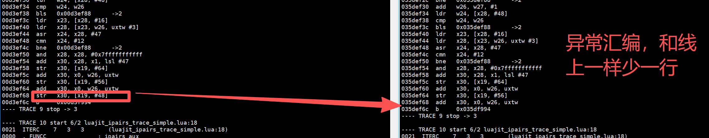

## 5. Fixing production

### 5.1 The code change

Once we understood the issue, we revisited the older `asm_tail_prep()`:

```c
static void asm_tail_prep(ASMState *as)
{
  MCode *p = as->mctop - 1;
  if (as->loopref) {
    as->invmcp = as->mcp = p;
  } else {
    as->mcp = p-1;
    as->invmcp = NULL;
  }
  *p = 0;
}
```

In the non-loop branch, `as->mcp` points to `p[-1]`, but only `*p` is cleared.

If `p[-1]` contains a stale instruction, `emit_lso()` can therefore mistake it for an instruction already generated by the current trace.

We chose a very small fix:

**Add `p[-1] = 0` to the non-loop branch of `asm_tail_prep()` so that no old instruction remains in the reserved slot.**

The modified code is:

```c
static void asm_tail_prep(ASMState *as)
{
  MCode *p = as->mctop - 1;
  if (as->loopref) {
    as->invmcp = as->mcp = p;
  } else {
    as->mcp = p-1;
    as->invmcp = NULL;

    /* Prevent load/store merging on reserved tail slot. */
    p[-1] = 0;  /* Added */
  }
  *p = 0;
}
```

Before the change:

```text
asm_tail_prep:
    p = T-1
    mcp = T-2

Memory:
T-1: 0
T-2: str x30, [x19, #56] ← may be a stale instruction
T-3: ...
```

After the change:

```text
asm_tail_prep:
    p = T-1
    mcp = T-2
    p[-1] = 0

Memory:
T-1: 0
T-2: 0 ← reserved slot has been cleared
T-3: ...
```

Even if another trace previously used this memory, the compiler will no longer begin the new trace with an old `STR` in the reserved slot.

When `emit_lso()` reads `*as->mcp`, the location has already been zeroed. A stale `STR` cannot trigger the incorrect merge, so the new `STR` is emitted normally.

### 5.2 Validation in production

After deploying the fix across the fleet, we continued monitoring workers on the ARM machines. The intermittent **100% CPU infinite loops previously observed across more than 2,000 ARM machines no longer occurred**.

We also stopped observing some of the earlier LuaJIT symptoms involving disappearing values and unexpected variable types.

Adding `p[-1] = 0` to `asm_tail_prep()` was effective for this ARM64 infinite-loop problem, consistent with our source analysis and fault-injection experiment.

However, we did not analyze the IR and machine code for every separate “disappearing value” incident. Those symptoms may also have involved incorrect JIT-generated memory-access instructions, but we cannot establish that all of them were caused by this particular incorrect `STR → STP` merge.

### 5.3 The upstream change

We originally used **OpenResty 1.19.3.1**, which bundled OpenResty's [luajit2](https://github.com/openresty/luajit2) at `v2.1-20201027`.

During the investigation, we independently upgraded luajit2 first to `v2.1-20241203` and then to `v2.1-20250529`. Neither upgrade resolved the problem.

Later, by comparing the upstream source, we found that **a LuaJIT refactoring committed on November 6, 2025 had already addressed this problem indirectly**.

The related issue and commit are:

- [LuaJIT issue #285: Increase available allocation range in mcode_alloc()](https://github.com/LuaJIT/LuaJIT/issues/285)
- [LuaJIT commit 68354f4: Allow mcode allocations outside of the jump range to the support code](https://github.com/LuaJIT/LuaJIT/commit/68354f444728ef99bb51bb4d86e8f1b40853a898)

The main purpose of that change was to expand the address range available for machine-code allocations and reduce constraints imposed by machine-code branch distances on architectures such as ARM64. It was not written specifically for the infinite loop we encountered.

However, the change also refactored `asm_tail_prep()` and `asm_tail_fixup()`.

**The older implementation:**

```c
static void asm_tail_prep(ASMState *as)
{
  MCode *p = as->mctop - 1;
  if (as->loopref) {
    as->invmcp = as->mcp = p;
  } else {
    as->mcp = p-1;
    as->invmcp = NULL;
  }
  *p = 0;
}
```

The problem in the older implementation is that the non-loop branch sets `as->mcp` to `p[-1]`, but the final zeroing operation clears `*p` instead.

**The relevant part of the newer implementation:**

```c
static void asm_tail_prep(ASMState *as, TraceNo lnk)
{
  MCode *p = as->mctop - 1;
  if (as->loopref) {
    as->invmcp = as->mcp = p;
  } else {
    if (!lnk) {
      MCode *target = (MCode *)(void *)lj_vm_exit_interp;
      if (!A64F_S_OK(target - p, 26) ||
          !A64F_S_OK(target - (p+1), 26)) p--;
    }
    p--;  /* Leave room for stack pointer adjustment. */
    as->mcp = p;
    as->invmcp = NULL;
  }
  as->mctail = p;
  *p = 0;  /* Prevent load/store merging. */
}
```

Two changes stand out:

1. **The reserved slot is initialized differently.** The newer implementation first determines the location of `as->mcp`, then executes `*p = 0`. Since `as->mcp = p` at that point, it clears exactly the location that `emit_lso()` may inspect. An old `STR` at that location cannot be mistaken for a pairing candidate.
2. **Tail code generation is restructured.** A new `as->mctail` records the trace-tail location. `asm_tail_fixup()` uses it to generate stack-pointer adjustments and branch instructions instead of relying entirely on the older fixed reserved-slot arrangement.

The most important part is:

```c
as->mcp = p;
...
*p = 0;  /* Prevent load/store merging. */
```

**The newer implementation determines the location first, then clears that location, preventing stale instructions from taking part in an incorrect merge.**

Although the upstream change primarily supported more flexible machine-code allocation, its restructuring of ARM64 tail generation also eliminated the problem we found.

The upstream commit does not explicitly state that it fixes this particular infinite-loop defect. That connection is our conclusion from comparing the older and newer source.

**Corresponding OpenResty versions**

Checking the OpenResty release history showed that the following versions include the relevant change:

- **luajit2:** `v2.1-20260311`
- **OpenResty:** `1.29.2.2`

The preceding OpenResty `1.29.2.1` used luajit2 `v2.1-20251022`, which did not yet include the upstream change from November 6, 2025.

**November 6, 2025 is the date of the upstream LuaJIT commit; OpenResty incorporated the change in a later release.** It would be incorrect to assume that every OpenResty release published in November 2025 already included the fix.

Readers running an older OpenResty on ARM64 and encountering similar worker loops or abnormal JIT-generated code can check their LuaJIT version and consider upgrading to:

- OpenResty `1.29.2.2` or a later stable release.
- luajit2 `v2.1-20260311` or later, if maintaining luajit2 separately.

Of course, not every infinite loop in an ARM64 worker has this cause. JIT logs and machine code are still needed to identify the actual problem.

Related release and source records:

- [Official OpenResty 1.29.2.x changelog](https://openresty.org/cn/changelog-1029002.html)
- [OpenResty luajit2 v2.1-20260311 source](https://github.com/openresty/luajit2/blob/v2.1-20260311/src/lj_asm_arm64.h)

For the older LuaJIT version we maintained, we ultimately chose the minimal `p[-1] = 0` change in `asm_tail_prep()`, without backporting the entire larger upstream refactoring.
