+++
title = "OpenResty Worker 莫名死循环：我们是怎么查出 LuaJIT ARM64 少生成了一条指令的？"
date = '2026-11-06T15:10:53+08:00'
slug = 'luajit-arm64-infinite-loop'
description = "从 CPU 100%、循环无法结束，到定位 LuaJIT ARM64 机器码中缺失的 STR 指令：一次线上问题的排查、复现与修复记录。"
tags = ['OpenResty', 'LuaJIT', 'ARM64', '问题排查']
draft = false
+++

> 一次持续了3年的线上排障记录。从 CPU 100%、循环无法结束，到最后发现 LuaJIT 在 ARM64 上生成机器码时，把本该执行的一条指令“弄丢了”。

我们的网关使用 OpenResty，业务逻辑主要用 Lua 编写。OpenResty 底层使用 LuaJIT，LuaJIT的jit模式会把 Lua 代码编译成 CPU 可以直接执行的机器码，以提高性能。对于正常开发而言，只需要关注上层的lua语法逻辑是否正确，但这次出问题在**jit的生成机器码上**。

## 1. 线上现象

刚开始线上的机器都是x86机器，工作一直正常。随着arm机器的引入，发现网关在arm机器上出现一系列luajit的问题。

这些现象只出现在**arm的机器上**，让我们开始怀疑 LuaJIT底层在arm机器上存在问题，最终我们在几台arm机器上关闭了jit模式，观察到同类死循环不再出现。这让我们将排查方向从业务代码逐渐转向 LuaJIT。但当时仍然不清楚是哪个编译环节存在问题，也没有找到稳定的复现方法

### 1.1 现象1，单个worker cpu 100%

线上发现在arm机器上，偶尔会出现nginx worker 长时间持续cpu100%

*   通过 gdb attach进程，利用[openresty-gdb-utils 工具](https://github.com/openresty/openresty-gdb-utils) 查看进程停留在一段for循环的代码，死循环中。每次死循环代码的位置不固定
*   一台机器上有40个worker，只有1-2个会出现问题。出现问题的时间不固定，可能7天出一次，也可能1天出几次。
*   有些Worker还伴随内存持续增长。原因在于这段死循环的代码里面有涉及到分配内存，一直死循环分配内存直到机器内存占满触发oom

其中一个现场在 `captcha_map.lua`，业务代码可以简化为：

```lua
local coordinates = {
    {x = 10, y = 20},
    {x = 30, y = 40},
    {x = 50, y = 60},
}

for idx, point in ipairs(coordinates) do
    -- 判断坐标是否满足条件
end
```

这个循环不应该无限执行。`idx` 理应从 1 增长到 2、3，最后结束。而实际上代码运行过程中`idx` 是1、2、3、1、2、3、1、2、3.....

**而在死循环的worker里，实际上代码运行过程中`idx` 是1、2、3、1、2、3、1、2、3.....** 这比普通的业务问题更棘手，Lua 源码中看不出死循环。

### 1.2 现象2，lua“不符合代码预期”的异常

在排查过程中，我们也遇到过类似“元素丢失”的线上现象。下面是来自另一份故障记录的两个例子。

**例子 A：先判断是字符串，后面却报 `nil`。**

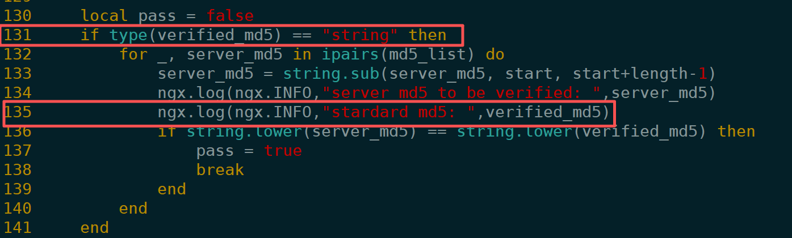

131行代码先检查 `verified_md5` 是字符串，再进入后续处理；在135行的时候，打印日志 `verified_md5`一定要是一个字符串类型

但运行时，135行的日志却说 `verified_md5`是一个nil类型

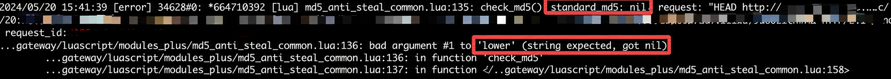

**例子 B：设置变量为整数，使用的时候却说变量是函数。**

例如下图，首先赋值 **local times = 0** , 这个代码执行意味着number 一定是数字类型

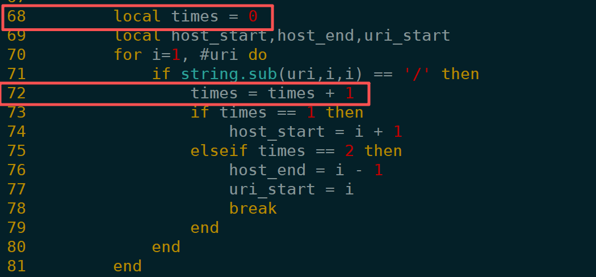

但在运行 **times = times +1** 的时候，却报错time变量是一个函数类型

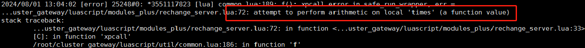

## 2. 现象出现概率低，无法复现

在线上arm机器大概有2千台，每台40个worker，出现问题worker数量大概一天1-3个，分布在不同机器。

最初我们和排查普通线上问题一样，从业务代码、日志和复现入手，但一直找不到稳定的入口。

| 尝试过的方法                               | 遇到的问题                       |
| ------------------------------------ | --------------------------- |
| 检查 Lua 业务代码                          | 循环条件正常，看不出会死循环的原因           |
| 开启LuaJIT编译断言assert                   | 运行正常，没有在发生死循环前触发assert      |
| 尝试2次更新 LuaJIT 版本                     | 当时的尝试没有消除问题                 |
| 购买了openresty-xray服务，在线录制执行worker执行过程 | 录制性能开销大，业务原因无法长时间开启         |
| 根据日志把线上请求导出，在线下回放                    | 无法复现                        |
| 根据触发请求的域名缩小范围，尝试找到是否部分功能引起jit问题      | 涉及的域名仍然很多，难以锁定哪几个域名的业务会造成影响 |

在定位根因之前，只能先通过监控高CPU持续100%、单worker内存分配超过10G，定时扫描错误日志，对故障 Worker 执行kill -9 处理，让master重新拉起worker。这是**止血方案，不是修复**。

后来我们换了一个思路：

**既然无法稳定复现，那就直接研究已经出问题的 Worker 到底执行了什么。**

我们在监控到死循环Worker时，向worker执行kill -6, 主动生成Core Dump，用 GDB 查看core当时的所有寄存器和执行指令，再借助 Python 的 Unicorn 模拟器重放 Core 中的一段 ARM64 指令。模拟执行了大量指令后，发现程序计数器（PC，可以理解为“CPU 现在执行到哪一条指令”）持续回到一组相同的地址。

这说明重点不再是“Lua 代码中有没有写错循环”，而是：

1.  LuaJIT 把这段 Lua 代码编译成了什么？
2.  它生成的机器码有没有正确更新循环下标？
3.  如果机器码确实少了东西，究竟是 LuaJIT 源码中的哪一步导致的？

于是，我们决定从 LuaJIT 内部寻找证据入手。

## 3. 使用 jit.dump：找到异常worker相比正常worker，少了一行汇编代码

### 3.1 `jit.dump` 是什么？

LuaJIT 不会把所有 Lua 代码一次性编译。它会重点编译反复运行的“热点路径”，这样的编译结果叫 **Trace**。

可以把 Trace 理解成：**LuaJIT 发现某段代码经常运行，于是为这条执行路径制作了一份机器码快捷路线。** 一段循环可能关联不止一条 Trace，运行中也可能从一条 Trace 跳到另一条。

LuaJIT 自带 `jit.dump`，可以输出这些 Trace 的信息：Lua 字节码、JIT 内部指令（IR）、退出时的状态（SNAP），以及最终生成的机器码。

在openresty中，可以这样开启：

```lua
init_worker_by_lua_block {
    -- 放在block最开始
    require("jit.dump").on("tbirsm", "/tmp/luajit-traces.log" .. ngx.worker.pid())
    --下面才是业务逻辑
}
```

注意点：

1.  日志量可能很大，要做好清理工作
2.  **要尽量在lua最开始执行之前开启**，否则较早生成的 Trace 不一定出现在日志里。

jit日志/tmp/luajit-traces.log日志如下，每一条从上到下分为按"----"分割为3个部分：

1.  trace start，从---- TRACE 43 start开始, 说明是从哪个地方的lua代码开始进行jit编译，以及是从这个trace是从哪个trace开始派生出来
2.  IR：从---- TRACE 43 IR开始，LuaJIT 编译时用的一种中间表示。简单理解，它描述了“这段代码应该做什么”。
3.  机器码（mcode）：从---- TRACE 43 mcode开始，最终交给 ARM64 CPU 执行的汇编指令。它描述了CPU 实际会做什么

luajit编译代码的过程为加载lua文件-> 转化为字节码-> 记录运行热点转化为IR -> 把IR转化为汇编

如下：jit\_dump导出的部分日志

    ---- TRACE 43 start 5/1 lrucache.lua:90
    0031  TSETS    7   2   1  ; "next"       (lrucache.lua:90)
    0000  . . FUNCC               ; ffi.meta.__newindex
    0032  TSETS    2   7   0  ; "prev"       (lrucache.lua:91)
    0000  . . FUNCC               ; ffi.meta.__newindex
    0033  MOV      2   7       (lrucache.lua:92)
    0034  JFORL    3   5       (lrucache.lua:87)
    ---- TRACE 43 IR
    0001 x27      int SLOAD  #5    PI
    0002 x28      int SLOAD  #6    PRI
    0003 x25      p64 PVAL   #10
    0004 [8]      cdt CNEWI  +161  0003
    ....              SNAP   #0   [ ---- ---- ---- ---- ---- 0001 0002 +1   ---- 0004 ---- ]
    ...........
    ---- TRACE 43 mcode 188
    ffff8d5bfa60  mov   x25, x28
    ffff8d5bfa74  mov   w1, #16
    ...
    ffff8d5bfb10  add   x30, x0, x1, lsl #47
    ffff8d5bfb14  str   x30, [x19, #16]
    ffff8d5bfb18  b     0x8d5cfc0c
    ---- TRACE 43 stop -> 5

### 3.2 借助 Python 的 Unicorn 模拟器重放ARM64死循环

在线上worker发生异常后，向异常的worker发送kill -6主动生成core文件。通过gdb 调试core文件，通过bt命令查看堆栈。如下：

    (gdb) bt
    #0  0x0000ffff8d4072e8 in ?? ()
    #1  0x0000ffe5181ddb80 in ?? ()
    #2  0x0000000001447740 in ?? ()
    #3  0x0000000000000000 in ?? (

看到的都是??的代码符号，这是因为。GDB 能读取 Core 中的寄存器和内存，但 LuaJIT 在运行时生成的机器码，并不像普通 C 函数一样具有完整的调试符号。因此，直接使用bt查看时，往往只能看到机器码地址，无法知道它对应哪一行 Lua 代码。

这个死循环的worker堆栈，其中#0 对应的 0x0000ffff8d4072e8 就是pc当前指向的地址，也是luajit中jit编译生成机器码的地址。#1 则没有意义，因为jit里机器码调用无法正常展开堆栈。

正常的堆栈如下

```(gdb) bt
#0  epoll_wait (epfd=5, events=0x145acc0, maxevents=512, timeout=timeout@entry=63979) at ../sysdeps/unix/sysv/linux/epoll_wait.c:30
#1  0x000000000044b808 in ngx_epoll_process_events (cycle=0x14d1f60, timer=63979, flags=1) at src/event/modules/ngx_epoll_module.c:800
#2  0x0000000000442d56 in ngx_process_events_and_timers (cycle=cycle@entry=0x14d1f60) at src/event/ngx_event.c:257
#3  0x0000000000449c72 in ngx_worker_process_cycle (cycle=cycle@entry=0x14d1f60, data=data@entry=0x0) at src/os/unix/ngx_process_cycle.c:811
#4  0x0000000000448687 in ngx_spawn_process (cycle=cycle@entry=0x14d1f60, proc=0x449c00 <ngx_worker_process_cycle>, data=0x0, 
    name=0x539267 "worker process", respawn=respawn@entry=1) at src/os/unix/ngx_process.c:199
#5  0x000000000044ad81 in ngx_reap_children (cycle=0x14d1f60) at src/os/unix/ngx_process_cycle.c:678
#6  ngx_master_process_cycle (cycle=<optimized out>) at src/os/unix/ngx_process_cycle.c:180
#7  0x00000000004231d8 in main (argc=<optimized out>, argv=<optimized out>) at src/core/nginx.c:385
```

这里我们再写一个 Python 脚本，去读死循环 core 文件里面的寄存器信息，模拟寄存器执行机器码。执行发现，pc指针一直在某一条机器码上来回执行。比如ffff8d4072e8

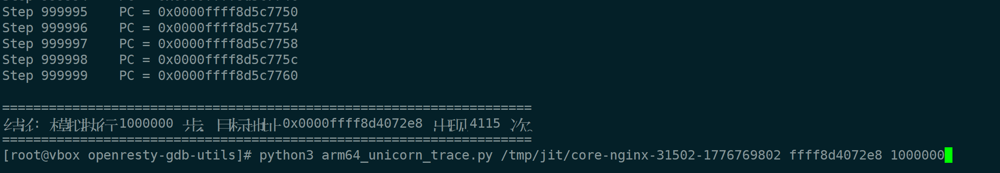

在我们开启的jit日志/tmp/luajit-traces.log中，找到这个ffff8d4072e8地址，发现它就是jit编译的代码中trace 2235的起始地址，部分jit日志如下:

```(gdb) bt
---- TRACE 60 start captcha_map.lua:278
---- TRACE 60 IR
ffff8d5c8118 mov x7, #0x3a98
.........
ffff8d5c8348 b   0xffff8d5c77ec

---- TRACE 64 start 60/3 captcha_map.lua:279
---- TRACE 64 IR
---- TRACE 64 mcode 320
ffff8d5c76a4 mov x7, #0x3a98
.........
ffff8d5c787c b   0xffff8d5c77ec

---- TRACE 2235 start 64/3 captcha_map.lua:279
0005  TGETS    9   8   1  ; "x"       (captcha_map.lua:279)
...
0022  JITERL   7  60       (captcha_map.lua:278)
---- TRACE 2235 IR
.....
---- TRACE 2235 mcode 320
ffff8d4072e8 mov x27, x26
.........
ffff8d407424 b 0x8d5c8118
---- TRACE 2235 stop -> 60
```

根据core的模拟寄存器运行的pc指向记录，结合 `jit.dump`、Core 和 GDB，我们找到了这样一条执行链：

```text
TRACE 60  →  TRACE 64  →  TRACE 2235
    ↑                         |
    └─────────────────────────┘
```

看到pc的地址，一直在Trace 60, Trace 64, Trace2235 的机械码之间有回跳，说明死循环发生在这个trace链条里。

根据我们找到导出的jit日志，Trace 60, Trace 64, Trace2235对应的lua代码如下，为一个278行的for循环。
如下图：
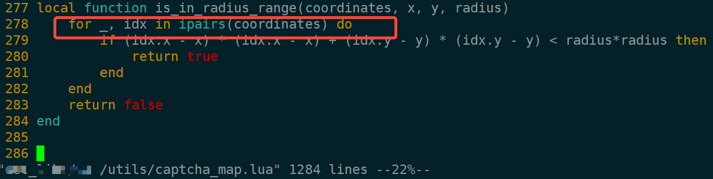

通过分析代码，我们推断其中的`coordinates` 数组长度一定是3，`idx` 应该从1、2、3、跳出结束，但`idx`实际运行却是1、2、3、1、2、3....一直循环。

注：这里idx必须是1、2、3循环，不可能1、2、3、4....因为`coordinates` 数组长度是3，如果`idx`为4时，超过数组长度一定会报错或者终止循环。

现在找到了死循环的worker了，代码看不出问题。那么我们对比下正常的worker，看看正常 worker 对同样代码生成的 JIT 日志是否有差异。

如下图所示：

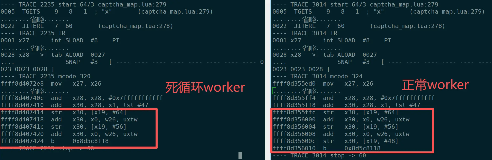

左边是死循环worker，右边是正常worker，我们通过对比，发现jit日志基本都一样，唯一差别为jit日志中生成的汇编代码中左边死循环worker中最后有`2个str指令`，右边正常worker中有`3个str指令`，

*   2个worker字节码完全相同
*   IR 完全相同，包括 snapshot
*   但 `mcode` 大小不同：**2235 是 320 字节，3014 是 324 字节**

ARM64 指令定长 4 字节，差的正好是一条指令。看两段机器码的结尾：

1.  左边和右边的worke倒数第一都是b指令，看起来是跳到一个另一个地址，这个地址就是TRACE  60的地址。
2.  左边的倒数第二条指令和右边倒数第三条一样是add指令，这意味着对一个寄存器进行加法运算
3.  右边的倒数第二条指令是str指令（左边缺失），看着是把一个寄存器的值写回到一个地址

```asm
; 正常 trace 3014
add  x30, x28, x1, lsl #47
str  x30, [x19, #64]      ; slot 10
add  x30, x0, w26, uxtw
str  x30, [x19, #56]      ; slot 9
add  x30, x0, w26, uxtw
str  x30, [x19, #48]      ; slot 8   <-- 正常有
b    <跳回 trace 60>

; 死循环 trace 2235
add  x30, x28, x1, lsl #47
str  x30, [x19, #64]      ; slot 10
add  x30, x0, w26, uxtw
str  x30, [x19, #56]      ; slot 9
add  x30, x0, w26, uxtw   ; 值算出来了
b    <跳回 trace 60>      ; 但 slot 8 的 str 没有了
```

对应 IR 里的 snapshot （节选）：

    0023 x26 int ADD 0001 +1 ...
    SNAP #3   [ ---- ---- ---- ---- ---- ---- ---- ---- 0023 0023 0028 ]
                                                        slot8 slot9 slot10

第一行的意思很简单：**循环下标加 1**。`SNAP` 记录的是当 Trace 退出等情况下，需要恢复的 Lua 状态。它不是逐条机器码的清单，但可以帮助我们检查计算后的值是否正确传递。

slot 8 就是 `ipairs` 的循环控制变量，ref `0023` 是自增后的新索引（`ADD 0001 +1`）。这个 store 丢了，下一轮迭代(回到trace 60)通过 `SLOAD #8` 读到的永远是旧索引，循环就在同一个元素上无限转下去。

为了更直观地理解为什么少了一条 `STR` 就会导致死循环，我们结合 TRACE 60、64、2235 的执行过程来看一下。

先解释两条指令：

*   `SLOAD #8`：从 Lua 栈的 slot 8 读取循环下标 `idx`。
*   `STR x30, [x19, #48]`：把计算好的新下标（编码为 Lua 值后）写回 slot 8。

**正常情况下：**

    TRACE 60
        从 slot 8 读取 idx，假设当前为 1
            ↓
    TRACE 64
        继续执行循环中的代码，推进循环下标
            ↓
    TRACE 2235
        假设计算得到新的 idx = 4
        执行 STR，将新下标 4 写回 slot 8
            ↓
    跳回 TRACE 60
        从 slot 8 读取 idx = 4
        使用更新后的下标继续执行或结束遍历

**异常情况下（TRACE 2235 少了一条 STR）：**

    TRACE 60
        从 slot 8 读取 idx = 1
            ↓
    TRACE 64
        继续执行循环中的代码，推进循环下标
            ↓
    TRACE 2235
        计算得到新的 idx = 4
        但缺少 STR，没有写回 slot 8
            ↓
    跳回 TRACE 60
        从 slot 8 读取 idx，发现仍然是 1
            ↓
    TRACE 64 → TRACE 2235 → TRACE 60
        反复执行，形成死循环

**问题的关键是：循环下标在寄存器中已经计算出了新值，但没有正确写回 Lua 栈。**

由于 TRACE 2235 最后又跳回 TRACE 60，而 TRACE 60 重新从 slot 8 读取循环下标，读取到的仍然是旧值，导致相同的 Trace 执行路径不断重复，最终出现死循环。

至此，我们第一次把问题从“Lua 遍历出现死循环”缩小到了一个非常具体的现象：

**LuaJIT 已经计算出了新的循环下标，但最终生成的 ARM64 机器码却缺少一条必要的** `STR` **写回指令。**

那么，这条指令为什么会消失？

是 LuaJIT 在生成汇编时遗漏了它，还是指令曾经生成，却在后续代码生成过程中被覆盖？

带着这个疑问，我们开始阅读 LuaJIT 的 ARM64 汇编器源码，重点分析 `lj_asm_arm64.h` 和 `lj_emit_arm64.h`，试图找出这条指令消失的真正原因。

结论：

> **异常的worker少了一行汇编指令，问题出在代码生成阶段，而不是 IR 或业务逻辑**。

## 4. 源码分析

阅读源码时，我们还参考了 Kong 的一篇 ARM64 排障文章：[Troubleshooting an Intermittent Failure on ARM64](https://konghq.com/blog/engineering/troubleshooting-an-intermittent-failure-on-arm64)，它让我们注意到 ARM64 上的内存指令合并优化

另外我们也看到源码中 emit\_lso函数中也有一行注释，说明str指令会进行合并。

因此，初步的猜想会不会是这个丢失的str指令其实是生成的，只是由于合并的原因被丢失了。

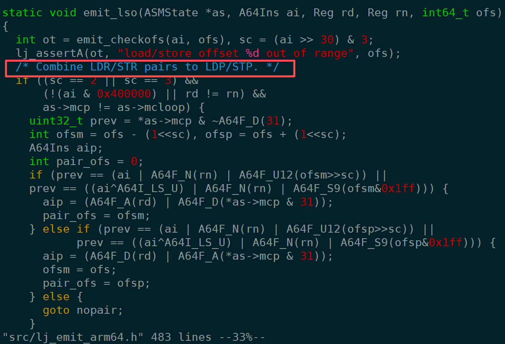

### 4.1 先了解几个背景

**背景一：多个 Trace 的机器码可能位于相邻的 JIT 内存区域。**

我们观察 `jit.dump` 输出的三条连续 Trace：

    ---- TRACE 2233 mcode 128
    ffff8d40747c ldr x30, [x22, #368]
    ......
    ffff8d4074f8 b   0x8c6bcd28
    ---- TRACE 2233 stop -> interpreter

    ---- TRACE 2234 mcode 24
    ffff8d40744c mov x0, #0
    ......
    ffff8d407460 b   0x8c6bcd28
    ---- TRACE 2234 stop -> interpreter

    ---- TRACE 2235 mcode 320
    ffff8d4072e8 mov x27, x26
    ......
    ffff8d407424 b   0x8d5c8118
    ---- TRACE 2235 stop -> 60

<!---->

    TRACE 2233：ffff8d40747c ... ffff8d4074f8
    TRACE 2234：ffff8d40744c ... ffff8d407460
    TRACE 2235：ffff8d4072e8 ... ffff8d407424

这三条 Trace 的代码地址越来越低。LuaJIT 的 ARM64 汇编器会从高地址向低地址发射机器码。由此我们想到：不同 Trace 的编译过程，有没有可能反复使用之前占用过的内存？
可以看到，在这一段机器码内存区域中，后生成的 Trace 使用了更低的地址。

阅读 LuaJIT 的机器码分配与 ARM64 汇编器源码后，我们了解到，LuaJIT 会在分配的机器码区域内组织多条 Trace，并且 ARM64 汇编器通常**从高地址向低地址发射指令**。

这让我们想到一种可能：**如果前一次编译中途失败，已经写进机器码区域的内容是否会保留下来，并被下一次编译重新碰到？**

**背景二：Trace 编译可能失败（abort），并留下已经写过的机器码。**

在线上日志中，我们看到很多类似记录：

    ---- TRACE 2235 abort sbw_preload_up_rewrite_pre.lua:47
    ---- TRACE 2235 start config.lua:569
    ---- TRACE 2235 abort config.lua:590
    ---- TRACE 2235 start ssl_cert_by.lua:108
    ---- TRACE 2235 abort ssl_cert_by.lua:140

`abort` 表示这一次 Trace 编译没有成功。失败后，相关机器码空间可能被后续编译复用，但之前写入的字节不会清空。

部分相关代码如下：

从源码可以看到，`lj_mcode_abort()` 在这条路径下主要是调用 `mcode_protect()`，将机器码内存区域恢复到运行时的内存保护状态。

它并没有清空已经写入的机器码，也没有提交本次编译所占用的空间。

因此，如果某次 Trace 已经进入机器码生成阶段，写入了部分指令，随后因为异常中止，那么这些字节可能仍然保留在原来的内存位置，等待后续编译复用。

```
static int trace_abort(jit_State *J)
{
  ....
  lj_mcode_abort(J);
}

/* Abort the reservation. */
void lj_mcode_abort(jit_State *J)
{
  if (J->mcarea)
    mcode_protect(J, MCPROT_RUN);
}

static void mcode_protect(jit_State *J, int prot)
{
  if (J->mcprot != prot) {
    if (LJ_UNLIKELY(mcode_setprot(J->mcarea, J->szmcarea, prot)))
      mcode_protfail(J);
    J->mcprot = prot;
  }
}

```

**背景三：ARM64 的 `emit_lso()` 会尝试合并相邻内存指令。**

阅读 `lj_emit_arm64.h` 时，我们关注到 `emit_lso()` 中把相邻 `LDR/STR` 合并为 `LDP/STP` 的优化。例如：

    str x4,  [x19, #48]
    str x30, [x19, #56]

在满足配对条件时，可以合并成一条 `STP`：

    stp x4, x30, [x19, #48]

这本来是正常的优化。问题在于：**如果汇编器读取的“可配对指令”不是这次编译刚生成的，而是内存里的旧内容，会怎么样？**

**背景四：编译 Trace 时，尾部会预留一到两个指令槽位。**

在旧版 `lj_asm_arm64.h` 的 `asm_tail_prep()` 中，非 loop 分支会预留两个槽位，其中一个留给后续跳转，另一个留给栈指针调整：

    MCode *p = as->mctop - 1;
    as->mcp = p - 1;
    as->invmcp = NULL;
    *p = 0;

注意：这里只清零了 `*p`，并没有清零 `p[-1]`。而 `as->mcp` 恰好指向 `p[-1]`。

至此，我们形成一个猜测：**如果预留槽 `p[-1]` 中残留了一条旧 `STR`，`emit_lso()` 会不会误把它当作当前 Trace 的指令来参与合并？**

### 4.2 我们当时推测过程

结合前面的几个背景，我们尝试模拟一种场景：

1.  某次 Trace 编译失败，在机器码内存中留下了一条 `STR`。
2.  后续一个较短的 Trace 编译成功，只覆盖部分旧指令。
3.  再下一次 Trace 编译时，恰好把残留的 `STR` 当作当前指令进行合并。

<!---->

    初始状态：J->mctop = T
    （T-1、T-2 表示相邻的指令槽，每个槽占 4 字节）

    ━━━━━━━━━━━━━━━━━━━━━━━━━━━━━━━━━━━━━━━━━━━
    第一步：某个 trace 开始装配，然后 abort
    ━━━━━━━━━━━━━━━━━━━━━━━━━━━━━━━━━━━━━━━━━━━

    asm_tail_prep:
    p = T-1
    mcp = T-2 （预留两个 slot，其中 T-1 清零，T-2 未清零）

    *--mcp = ... mcp = T-3 ← 第1条汇编
    *--mcp = ... mcp = T-4 ← 第2条汇编
    *--mcp = ... mcp = T-5 ← 第3条汇编
    *--mcp = ... mcp = T-6 ← 第4条汇编 (str x30, [x19, #56]) ← 目标！
    *--mcp = ... mcp = T-7 ← 第5条汇编

    abort! 本次编译未提交，内存空间可以被后续 trace 复用，但不清空

    内存此刻：
    T-1: 0 ← asm_tail_prep 清零
    T-2: [未清零，可能保留旧内容]
    T-3: abort 后残留的汇编 ← abort 留下的
    T-4: abort 后残留的汇编 ← abort 留下的
    T-5: abort 后残留的汇编 ← abort 留下的
    T-6: str x30, [x19, #56] ← abort 留下的 ★
    T-7: abort 后残留的汇编


    ━━━━━━━━━━━━━━━━━━━━━━━━━━━━━━━━━━━━━━━━━━━
    第二步：另一个短 trace 成功编译
    ━━━━━━━━━━━━━━━━━━━━━━━━━━━━━━━━━━━━━━━━━━━

    这个 trace 只发射了 2 条普通指令
    asm_tail_prep: mcp = T-2
    *--mcp = ... mcp = T-3 ← 覆盖了 abort 留下的 T-3
    *--mcp = ... mcp = T-4 ← 覆盖了 abort 留下的 T-4
    asm_tail_fixup: T-1 = NOP，T-2 = branch ← 写入尾部跳转

    编译成功，J->mctop = T-4
    （假设是非 loop trace，且 spadj = 0）

    内存此刻：
    T-1: NOP ← 成功 trace 写的
    T-2: branch ← 成功 trace 写的
    T-3: 成功 trace 的指令 ← 覆盖了 abort 留下的
    T-4: 成功 trace 的指令 ← 覆盖了 abort 留下的
    T-5: abort 后残留的汇编 ← 未被覆盖
    T-6: str x30, [x19, #56] ← abort 留下的，未被覆盖！★
    T-7: abort 后残留的汇编


    ━━━━━━━━━━━━━━━━━━━━━━━━━━━━━━━━━━━━━━━━━━━
    第三步：bug trace 开始编译，内存空间从 T-4 开始
    ━━━━━━━━━━━━━━━━━━━━━━━━━━━━━━━━━━━━━━━━━━━

    asm_tail_prep:
    p = T-5
    mcp = T-6 ← abort 留下的，内容为 str x30, [x19, #56]，未被覆盖！★

    准备生成第一条汇编：str x30, [x19, #48]
    emit_lso 读取 *mcp，即 T-6 的旧指令：str x30, [x19, #56]
    发现新旧两条 STR 的内存偏移分别是 #48 和 #56，相差 8 字节，符合 STR → STP 合并条件

    *mcp = stp x30, x30, [x19, #48]
        ← 合并后的 STP 写在 T-6
        ← 合并成功直接 return，mcp 不向低地址移动

    *--mcp = ... mcp = T-7
        ← 第二条汇编 add x30, x0, w26, uxtw

    asm_tail_fixup:
    T-5 = NOP
    T-6 = branch ← 覆盖刚才合并生成的 STP

    内存此刻：

    T-1: NOP ← 上一个成功 trace 写的
    T-2: branch ← 上一个成功 trace 写的
    T-3: 成功 trace 的指令 ← 上一个 trace 写的
    T-4: 成功 trace 的指令 ← 上一个 trace 写的
    T-5: NOP ← bug trace 写的
    T-6: branch ← bug trace 写的，覆盖了原来的 STP
    T-7: add x30, x0, w26, uxtw ← bug trace 写的
         原本应该生成的 str x30, [x19, #48] 丢失！★

查看线上出现死循环的jit日志，出问题的是trace 2235。在此之前经历了(32个trace 2234失败，一个2234 trace成功，55个trace2235失败)。这些频繁的编译失败和重试，使我们更加怀疑机器码内存复用过程中存在残留指令，导致合并

### 4.3 尝试线下复现

为了验证这个猜测，我们编写了一段简化的 Lua 测试代码，尽量还原线上 `captcha_map.lua` 中的循环逻辑。
测试数据同时包含整数和浮点数，目的是让 LuaJIT 生成与线上 TRACE 2235 结构相似的 IR 和机器码。
在不注入故障的情况下，测试程序能够正常结束，在arm平台上生成的相关 Trace 与线上故障 Trace 具有相似的循环尾部结构。

    --LUAJIT_REPRO_FORCE_TAILPAIR_TRACE=9 LUAJIT_REPRO_DUMP=/tmp/jit_repro_force.dump ./luajit /root/zengjinji/luajit_ipairs_trace_simple.lua

    local jit = require("jit")
    jit.off()
    local dump_path = os.getenv("LUAJIT_REPRO_DUMP")
    local dump_flags = "tbirsm"
    local warmup_iters = 200

    local target_iters = 20

    local function force_number(v)
      return v + 0.1 - 0.1
    end

    local function is_in_radius_range(coordinates, x, y, radius)
        for _, idx in ipairs(coordinates) do
            if (idx.x - x) * (idx.x - x) + (idx.y - y) * (idx.y - y) < radius * radius then
                return true
            end
        end
        return false
    end

    local int_coordinates = {
        { x = 135, y = 119 },
        { x = 202, y = 202 },
        { x = 326, y = 148 },
        { x = 403, y = 198 },
    }

    local mixed_coordinates = {
        { x = 135, y = 119 },
        { x = 202, y = 202 },
        { x = force_number(326), y = force_number(148) },
        { x = 403, y = 198 },
    }

    local int_x = 231
    local int_y = 106
    local num_x = force_number(231)
    local num_y = force_number(106)
    local radius_num = force_number(60 * 1.5)
    jit.on()
    jit.opt.start("hotloop=1", "hotexit=1")
    jit.flush()

    require("jit.dump").on(dump_flags, dump_path)


    for _ = 1, warmup_iters do
        is_in_radius_range(int_coordinates, int_x, int_y, radius_num)
    end
    for _ = 1, warmup_iters do
        is_in_radius_range(int_coordinates, num_x, num_y, radius_num)
    end
    for _ = 1, warmup_iters do
        is_in_radius_range(mixed_coordinates, num_x, num_y, radius_num)
    end
    for _ = 1, target_iters do
        is_in_radius_range(mixed_coordinates, num_x, num_y, radius_num)
    end

导出生成的jit和线上对比，如下图：

将模拟生成的 Lua 代码经 JIT 编译后的 IR 和汇编码，与线上出问题的 TRACE 2235 对比，基本一致

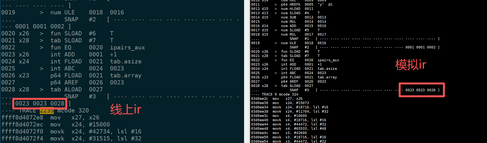

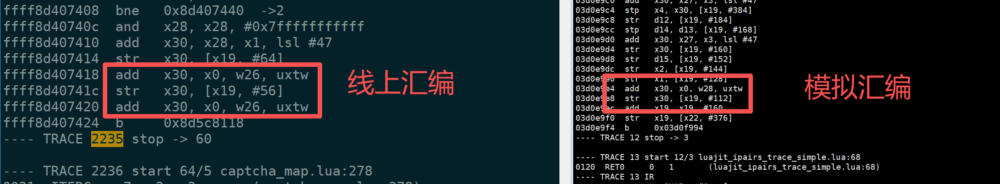

单纯运行测试脚本，我们无法稳定复现线上出现的旧指令残留。因此，我们修改了 LuaJIT 源码(基于v2.1-20201027版本)，增加一个仅用于测试的故障注入开关。

当编译指定的 TRACE 9 时，主动向 `asm_tail_prep()` 的预留槽 `p[-1]` 写入一条 `STR x30, [x19, #56]`，模拟这块内存残留旧指令的情况。

随后观察 `emit_lso()` 是否会把这条人为注入的旧指令，与本次准备生成的 `STR x30, [x19, #48]` 错误合并。

    --- a/src/lj_asm_arm64.h
    +++ b/src/lj_asm_arm64.h
    @@ -1987,8 +1987,28 @@ static void asm_tail_prep(ASMState *as)
       if (as->loopref) {
         as->invmcp = as->mcp = p;
       } else {
    +    const char *force_tailpair_trace = getenv("LUAJIT_REPRO_FORCE_TAILPAIR_TRACE");
    +    int force = 0;
         as->mcp = p-1;  /* Leave room for stack pointer adjustment. */
         as->invmcp = NULL;
    +    if (force_tailpair_trace)
    +      force = as->T->traceno == (TraceNo)atoi(force_tailpair_trace);
    +    if (force) {
    +      /* Proof knob: leave a fake stale STRx [BASE,#56] where emit_lso() peeks.
    +      ** A following STRx [BASE,#48] can be paired here without decrementing mcp;
    +      ** asm_tail_fixup() later overwrites this reserved slot with the tail branch.
    +      */
    +      p[-1] = A64I_STRx | A64F_D(RID_TMP) | A64F_N(RID_BASE) | A64F_U12(56 >> 3);
    +    }

重新编译 LuaJIT 并运行测试脚本后，观察到进程 CPU 持续保持 100%，测试程序无法正常结束。

对比开启和关闭故障注入时的 `jit.dump`，发现开启注入后的 TRACE 9 也缺少了写回循环下标的 `STR` 指令，与线上 TRACE 2235 的异常表现一致。

这说明，只要在预留槽中人为构造一条满足条件的旧 `STR`，就能够触发相同类型的错误代码生成，并引起死循环。

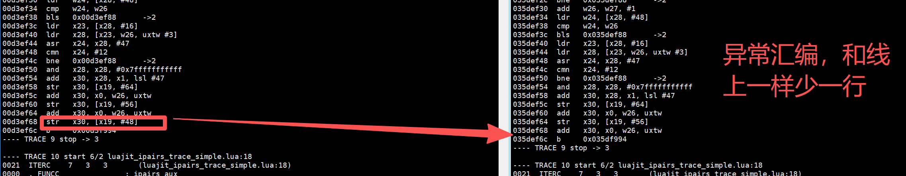

## 5. 线上修复

### 5.1 代码修复

确定问题后，我们重新检查了旧版 `asm_tail_prep()`：

    static void asm_tail_prep(ASMState *as)
    {
      MCode *p = as->mctop - 1;
      if (as->loopref) {
        as->invmcp = as->mcp = p;
      } else {
        as->mcp = p-1;
        as->invmcp = NULL;
      }
      *p = 0;
    }

在非 loop 分支中，`as->mcp` 指向 `p[-1]`，但是只清零了 `*p`。

这意味着，如果 `p[-1]` 中残留了旧指令，后面的 `emit_lso()` 就可能把它误认为当前 Trace 已经生成的指令。

所以最终选择了一个非常简单的修复方案：

**在** `asm_tail_prep() `**的非 loop 分支中，增加** `p[-1] = 0` **，确保预留槽不会残留旧指令。**

修改后的源码：

    static void asm_tail_prep(ASMState *as)
    {
      MCode *p = as->mctop - 1;
      if (as->loopref) {
        as->invmcp = as->mcp = p;
      } else {
        as->mcp = p-1;
        as->invmcp = NULL;

        /* Prevent load/store merging on reserved tail slot. */
        p[-1] = 0;  /* 新增 */
      }
      *p = 0;
    }

修改之前：

    asm_tail_prep:
        p = T-1
        mcp = T-2

    内存：
    T-1: 0
    T-2: str x30, [x19, #56] ← 可能残留旧指令
    T-3: ...

修改之后：

    asm_tail_prep:
        p = T-1
        mcp = T-2
        p[-1] = 0

    内存：
    T-1: 0
    T-2: 0 ← 预留槽清零
    T-3: ...

这样即使这块机器码内存之前被其他 Trace 使用过，也不会在开始编译时将预留槽中的旧 `STR` 当成当前指令。

`emit_lso()` 读取 `*as->mcp` 时，由于该位置已经清零，不会因为旧的 `STR` 而触发错误合并，新的 `STR` 就可以正常生成。

### 5.2 线上验证

代码修复全网上线后，我们继续观察 ARM 机器上的 Worker 运行情况，之前2000多台arm机器偶发的 **CPU 100% 死循环现象不再出现**。

同时，之前遇到的部分 LuaJIT “元素丢失”、变量类型异常等问题也没有再观察到。

这说明在 `asm_tail_prep()` 中增加 `p[-1] = 0`，对解决本次 ARM64 死循环问题是有效的，也与之前通过源码分析和故障注入得到的结论一致。

不过，对于其他“元素丢失”问题，目前没有逐一分析对应的 IR 和机器码。虽然它们也可能与 JIT 生成的内存读写指令异常有关，但还不能确定所有问题都由这次 `STR → STP` 错误合并引起。

### 5.3 官方修复

我们最初使用的是 **OpenResty 1.19.3.1**，对应的 LuaJIT 是 OpenResty 维护的 [luajit2](https://github.com/openresty/luajit2) `v2.1-20201027`。

在排查过程中，我们曾先后单独将 luajit2 升级到 `v2.1-20241203` 和 `v2.1-20250529`，但都没有解决问题。

后来通过对比官方源码发现，**LuaJIT 上游在 2025 年 11 月 6 日的一次代码重构中，已经间接解决了这个问题。**

相关提交：

*   [LuaJIT Issue #285：Increase available allocation range in mcode\_alloc()](https://github.com/LuaJIT/LuaJIT/issues/285)
*   [LuaJIT Commit 68354f4：Allow mcode allocations outside of the jump range to the support code](https://github.com/LuaJIT/LuaJIT/commit/68354f444728ef99bb51bb4d86e8f1b40853a898)

这次提交的主要目的是扩大机器码内存的可分配范围，减少 ARM64 等架构上机器码跳转距离带来的限制，并非专门针对我们遇到的死循环问题。

但是，这次修改也重构了 `asm_tail_prep()` 和 `asm_tail_fixup()` 的实现。

**旧版代码：**

    static void asm_tail_prep(ASMState *as)
    {
      MCode *p = as->mctop - 1;
      if (as->loopref) {
        as->invmcp = as->mcp = p;
      } else {
        as->mcp = p-1;
        as->invmcp = NULL;
      }
      *p = 0;
    }

旧版的问题在于，非 loop 分支中 `as->mcp` 指向 `p[-1]`，但最后清零的却是 `*p`。

**新版相关代码（节选）：**

    static void asm_tail_prep(ASMState *as, TraceNo lnk)
    {
      MCode *p = as->mctop - 1;
      if (as->loopref) {
        as->invmcp = as->mcp = p;
      } else {
        if (!lnk) {
          MCode *target = (MCode *)(void *)lj_vm_exit_interp;
          if (!A64F_S_OK(target - p, 26) ||
              !A64F_S_OK(target - (p+1), 26)) p--;
        }
        p--;  /* Leave room for stack pointer adjustment. */
        as->mcp = p;
        as->invmcp = NULL;
      }
      as->mctail = p;
      *p = 0;  /* Prevent load/store merging. */
    }

可以看到，新版主要有两个变化：

1.  **预留槽初始化方式改变。** 新版先确定 `as->mcp` 的位置，再执行 `*p = 0`。由于此时 `as->mcp = p`，清零的正是 `emit_lso()` 后续可能读取的位置，不会再把该位置残留的旧 `STR` 当作可配对指令。
2.  **尾部机器码生成逻辑重构。** 新增 `as->mctail` 来记录 Trace 尾部位置，`asm_tail_fixup()` 改为根据这个位置生成栈指针调整和跳转指令，而不是完全依赖旧版固定预留槽的方式。

其中，最关键的就是：

    as->mcp = p;
    ...
    *p = 0;  /* Prevent load/store merging. */

**新版先确定位置，再清零该位置，避免旧指令参与错误合并。**

因此，虽然官方这次修改主要是为了支持更灵活的机器码内存分配，但对 ARM64 Tail 生成逻辑的重构，也顺带消除了我们发现的这个问题。

需要说明的是，官方提交并没有明确声明修复了这次死循环缺陷，这是我们通过新旧源码对比得出的判断。

**对应的 OpenResty 版本**

进一步查看 OpenResty 的版本更新记录，确认包含上述代码改动的版本为：

*   **luajit2：** `v2.1-20260311`
*   **OpenResty：** `1.29.2.2`

而之前的 OpenResty `1.29.2.1` 使用的是 luajit2 `v2.1-20251022`，尚未包含 2025 年 11 月 6 日的上游改动。

需要注意，**2025 年 11 月 6 日是 LuaJIT 上游提交代码的时间，而 OpenResty 正式版本是在后续同步该修改的**，不能认为 2025 年 11 月发布的 OpenResty 版本都已经解决了问题。

因此，如果有读者在 ARM64 环境下使用旧版 OpenResty，也遇到了类似的 Worker 死循环、JIT 机器码异常等问题，可以检查当前 LuaJIT 的版本，并考虑升级到：

*   OpenResty `1.29.2.2` 或更新的正式版本。
*   如果单独维护 luajit2，则可以升级到 `v2.1-20260311` 或更新版本。

当然，并非所有 ARM64 上的 Worker 死循环都由这一问题引起，仍需要结合 JIT 日志和机器码进一步判断。

相关版本记录：

*   [OpenResty 官方 Changelog 1.29.2.x](https://openresty.org/cn/changelog-1029002.html)
*   [OpenResty luajit2 v2.1-20260311 源码](https://github.com/openresty/luajit2/blob/v2.1-20260311/src/lj_asm_arm64.h)

对于我们使用的旧版 LuaJIT，最终选择了在 `asm_tail_prep()` 中增加 `p[-1] = 0` 的最小修复方案，不需要将官方这次较大规模的代码重构全部移植过来。

